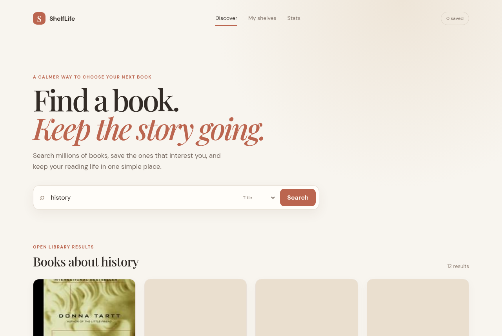
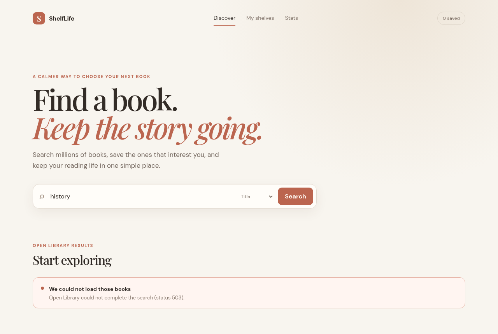

# ShelfLife

ShelfLife is a reading tracker. You search Open Library for a book, read what it
is about, and keep your own three shelves: Want to Read, Reading, and Finished.
Books you cannot find can be added by hand. Your shelves and your light or dark
choice are remembered between visits.

It is built with React and Vite and runs entirely in the browser. There is no
backend, no database and no server-side code. Requests go straight from the
browser to Open Library, and your shelves are stored in that browser's
`localStorage`.

## What you need

- **Node.js 20.19 or newer**, or 22.12 or newer. Vite 8 will refuse to start on
  anything older. Check yours with `node -v`.
- npm, which comes with Node.

**No API key is needed.** Open Library is free and open, so there is nothing to
sign up for, no key to paste in, and no `.env` file. That is also why there are
no environment variables in this project and nothing secret in the repository.

## Running it

```bash
npm install
npm run dev
```

Then open **http://localhost:5173** in a browser. Vite prints the address when it
starts, and it will pick a different port if 5173 is already busy.

To build the production version instead:

```bash
npm run build
npm run preview
```

## What is in it

| Page | What it does |
| --- | --- |
| **Discover** (`/`) | Search Open Library by title, author or subject. Results arrive as cards with covers. Load more fetches the next page |
| **Add a book** (`/add`) | A form for books Open Library does not have. Every field is checked before anything is saved |
| **Book details** (`/book/:id`) | The full description, subjects and cover, with buttons to put it on a shelf |
| **My shelves** (`/shelves`) | Your three shelves as tabs. A book lives on exactly one at a time |
| **Stats** (`/stats`) | A count per shelf and a breakdown of your books by decade |

Anything else goes to a not-found page with a way back.

## How it is put together

```
src/
  components/   BookCard, BookGrid, Header, StateMessage
  context/      ShelfContext, ThemeContext
  pages/        Home, AddBook, BookDetails, Shelves, Stats, NotFound
  services/     openLibrary.js
```

`openLibrary.js` is the only file that calls `fetch`. Everything that talks to
the API goes through it, so there is one place to get the error handling right.

Two values are shared through Context, each read with its own hook.
`useShelves()` gives the three shelves and the function that moves a book between
them. `useTheme()` gives the light or dark choice and the toggle. Both are saved
to `localStorage` whenever they change, and both reads are guarded so missing or
damaged data falls back to something sensible instead of breaking the app.

Colours are CSS variables on `:root`, with a dark set under
`[data-theme='dark']`, so both themes share one palette.

## Loading, error and empty states

Every request goes through `getJson` in `src/services/openLibrary.js`, which uses
`async`/`await` inside `try`/`catch`, checks `response.ok` so a non-2xx answer
counts as a failure, and turns a network failure into a readable sentence. Pages
clear their loading flag in a `finally` block, and a newer search aborts the one
still in flight with an `AbortController`, so an older response can never replace
newer results.

- **Loading** shows on the first load and on every search, with the previous
  results hidden while it is on screen.
- **Error** puts a readable message in the page and leaves the search box usable,
  so you can try again straight away.
- **Empty** shows "No books found", which never appears before the first search
  or during a request.

## Testing the error state

We tested the failure path in Chromium in three steps.

1. **Offline.** With the network switched off (DevTools, Network, Offline), we
   searched for "history". The page shows the error message rather than a blank
   area or a white screen.

   

2. **Recovery.** With the network back on, the same search returned results, so
   the app stays usable after a failure.

   

3. **Server error.** We made the search answer with HTTP 503. Because
   `response.ok` is checked, it is reported as a failure instead of being treated
   as an empty result.

   

To repeat the first one: run `npm run dev`, open DevTools, go to Network, set
throttling to **Offline**, and press Search.

## Form, theme and storage

These were taken in a separate browser profile, so the example book did not touch
anyone's own shelves.

| Screenshot | How to reproduce it |
| --- | --- |
| [Form errors](docs/phase4-form-errors.png) | Open Add a book. Enter a one-letter title, a number in the author name, and a year outside the shown range. Leave Shelf unselected and press Add to shelf. Nothing is saved |
| [Successful save](docs/phase4-form-saved.png) | Correct the four fields and press Add to shelf. The page confirms which shelf received the book |
| [Shelves after reload](docs/phase4-shelves-reloaded.png) | Open My shelves, reload, and select Reading again. The book and the counts are still there |
| [Dark mode after reload](docs/phase4-dark-reloaded.png) | Switch to dark mode, open a saved book, and reload. The page stays dark |
| [Phone layout](docs/phase4-mobile-dark.png) | Open Add a book at 390px wide with dark mode on. The navigation and the form fit the screen |

The example book is **The City and the City** by China Miéville (2009). Books
from Open Library use their cover when one exists. Everything else uses the
ShelfLife cover graphic in `public/`.

## How we worked

One repository, a branch for each person, and a pull request for every piece of
work. Nobody merged their own changes without somebody else reading them first,
so the commit history shows who wrote what.

## AI use

[docs/ai-reflection.md](docs/ai-reflection.md) records what we asked for, what we
kept, and what we rejected and why. [docs/phase4-prompt-log.md](docs/phase4-prompt-log.md)
is the log kept during Phase 4.
