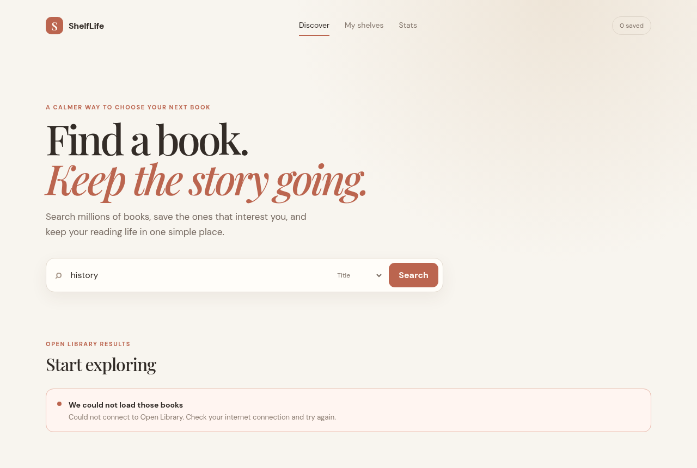

# ShelfLife

ShelfLife is a frontend-only React + Vite reading tracker for the ISTE 340 group project. It searches the Open Library API, shows book details, lets a user move books between three shelves, and keeps saved books in `localStorage`.

There is no backend, SQL database, or server-side code in this project. API requests are made directly from the browser, and shelf data is stored locally in the browser.

## Run locally

```bash
npm install
npm run dev
```

The application uses React Router for navigation, Context for shared shelf state, async/await for API requests, and responsive CSS for laptop and phone layouts. The `public/api-evidence.html` page is a static frontend evidence page for the Open Library request.

## Loading, error and empty states

Every Open Library request goes through `getJson` in `src/services/openLibrary.js`, which uses `async`/`await` inside `try`/`catch`, checks `response.ok` so a non-2xx answer counts as a failure, and turns a network failure into a readable message. The pages turn their loading flag off in a `finally` block, and a newer search aborts the one still in flight with an `AbortController`, so an older response can never replace newer results.

- **Loading:** shown on the first load and on every search, with the previous results hidden while it is on screen.
- **Error:** a readable message in the page; the search form stays usable, so the user can try again straight away.
- **Empty:** a search with no matches shows "No books found", which never appears before the first search or during a request.

## Testing the error state

We tested the failure path in Chromium in three steps:

1. **Offline.** With the network switched off (DevTools → Network → Offline), we searched for "history". The page shows the error message instead of a blank area or a white screen.

   

2. **Recovery.** With the network back on, we ran the same search again. The results loaded normally, so the app stays usable after a failure.

   

3. **Server error.** We made the search request answer with HTTP 503. Because `response.ok` is checked, it is reported as a failure rather than treated as an empty result.

   

To repeat the offline test yourself: run `npm run dev`, open the app, open DevTools → Network, set the throttling menu to **Offline**, and press **Search**.
